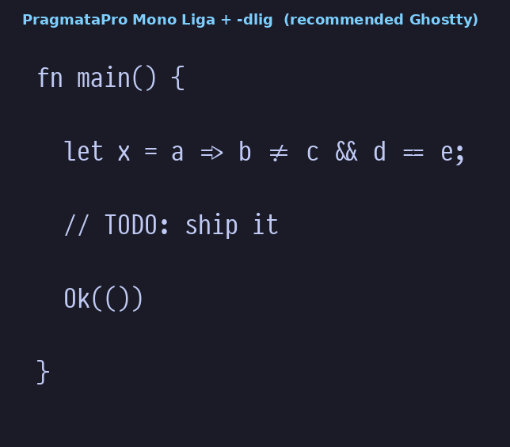
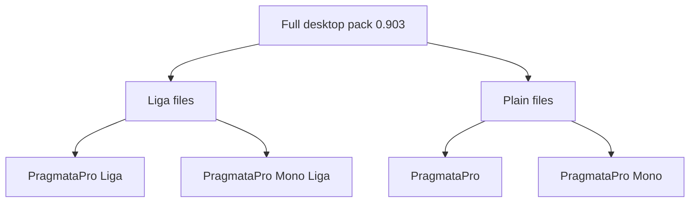
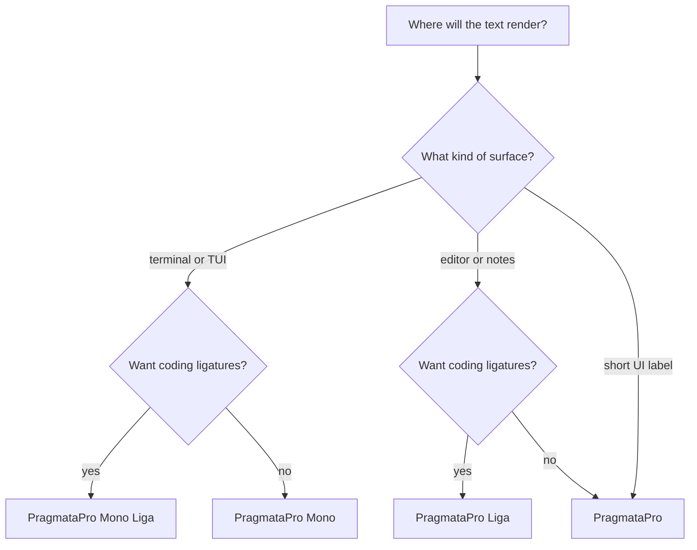
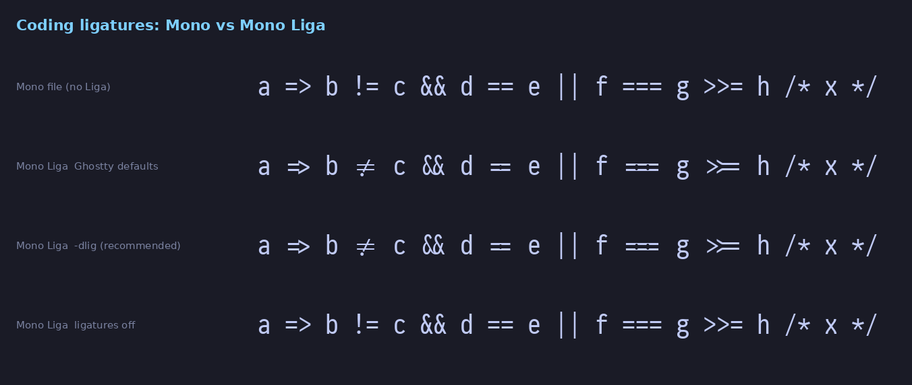
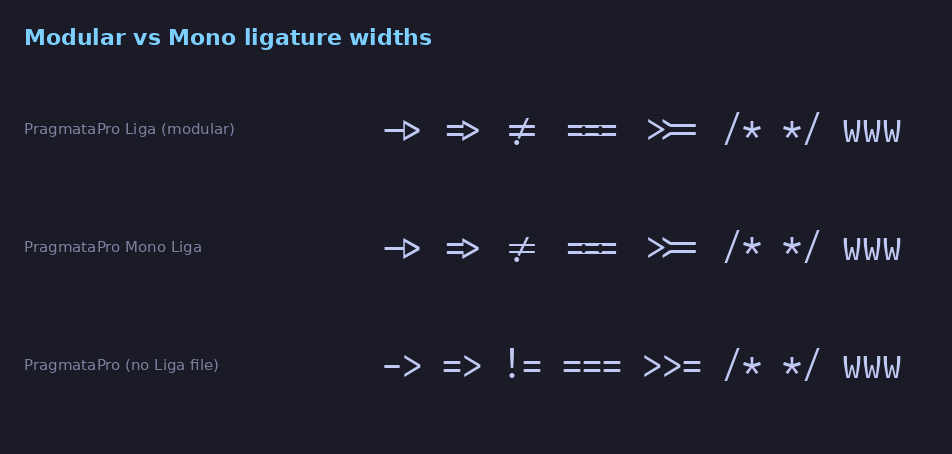
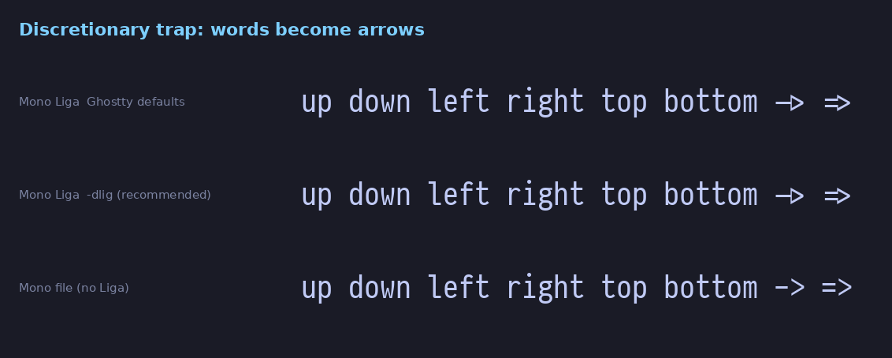
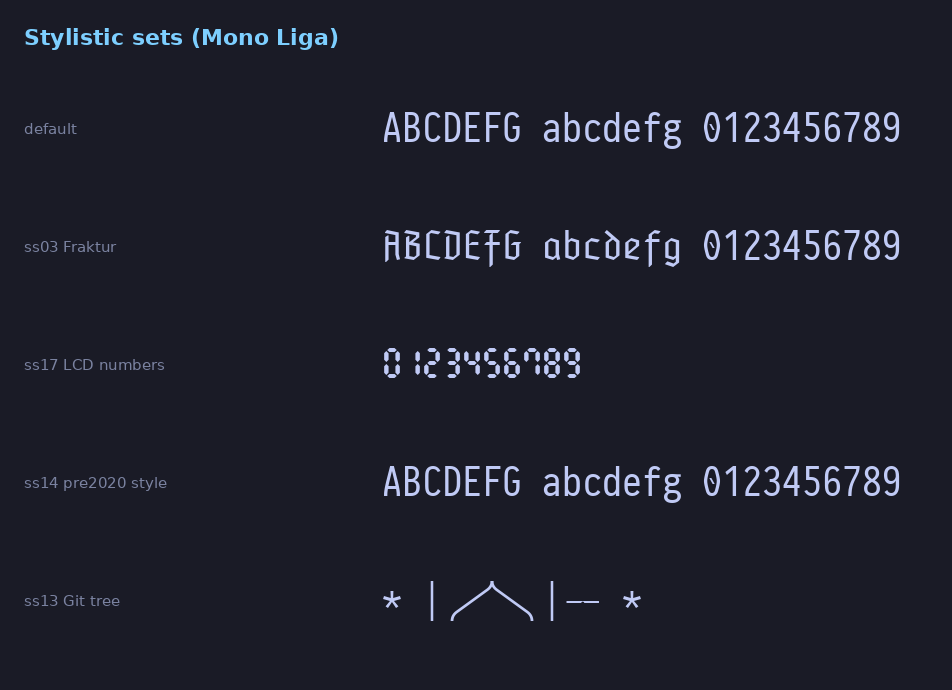
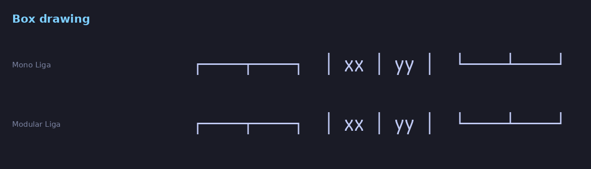

# PragmataPro

You own the full PragmataPro 0.903 desktop pack. This guide picks a family for each app, shows what the ligatures look like, and lists the OpenType features already in the files.

Ghostty is set to `PragmataPro Mono Liga` at size 16, with discretionary ligatures off. The theme stays `tokyonight`.



## TL;DR

| App | Family string | Ligatures | Features |
| --- | --- | --- | --- |
| Ghostty | `PragmataPro Mono Liga` | On, through `calt` in the Liga file | `font-feature = -dlig` |
| Rex | `PragmataPro Mono Liga` | Same as Ghostty | Set the family in the app UI. Public docs have no font key |
| IntelliJ editor | `PragmataPro Liga` | On, via Enable ligatures | Optional character variants such as `cv01` |
| IntelliJ terminal | `PragmataPro Mono Liga` | Follows the IDE ligature toggle | No Ghostty `font-feature` key |
| Sublime Text | `PragmataPro Liga` | On, via Sublime's default `calt` | Leave `dlig` out of `font_options` |
| Obsidian code | `PragmataPro Mono Liga` | `calt` on, `dlig` off | CSS in `docs/pragmatapro/obsidian/` |
| Hyprland groupbar | `PragmataPro` | Unused on short labels | Already set. Leave it |

Install the 16 desktop TTF files on macOS and on Omarchy. Keep the OTF-CFF copies for an app that asks for them. Keep the font files out of git. The license does not belong in this repo.

## What you own

The zip is four families. Each family has Regular, Italic, Bold, and Bold Italic. That is 16 TTF files, plus 16 optional OTF-CFF files. There are no web fonts in the zip. The variable font is a separate product.



**PragmataPro** is the modular family. Letters sit on one cell. Many symbols, icons, and ligatures use two or three cells. That looks natural in a GUI editor. It can shove a terminal column out of line.

**PragmataPro Mono** is the true monospace family. The font declares itself fixed-pitch. Almost every glyph is one cell wide. About 118 glyphs stay double width. Terminal columns stay put.

**Liga** changes the OpenType wiring. The drawings stay the same. `PragmataPro Liga` matches modular `PragmataPro`. `PragmataPro Mono Liga` matches `PragmataPro Mono`. The Liga files add a large `calt` table, about 435 lookups. The plain files keep a small `calt` table, about 29 lookups. Coding ligatures such as `=>` and `!=` turn on when the app enables `calt`. Ghostty and Sublime both do that. The plain files leave those ligatures off.

**Essential** is a smaller, cheaper, English-focused pack. It has no ligatures. This purchase is the full pack. The measured Regular files cover ASCII, Latin-1, box drawing, block elements, arrows, math operators, braille, a Fraktur block, Powerline private-use glyphs, and about 3,500 Nerd Font private-use glyphs. Modular Regular is 20,459 glyphs. Mono Regular is 17,509 glyphs.

Name ID 1 in the files is the family string in the table above. Confirm it with `ghostty +list-fonts` after install, in case a platform rewrites the spaces.

Sources: the 0.903 purchase zip, the [Handbook](https://github.com/fabrizioschiavi/pragmatapro/blob/master/useful_files/Handbook.png), the [shop page](https://fsd.it/shop/fonts/pragmatapro/), and the [0.903 changes](https://raw.githubusercontent.com/fabrizioschiavi/pragmatapro/master/useful_files/Changes_log.txt).

## Which family where



Use **PragmataPro Mono Liga** on any cell grid. That is Ghostty, Rex, and the IntelliJ terminal. Use **PragmataPro Liga** in a GUI editor that can spend a little extra width on symbols. That is the IntelliJ editor, Sublime Text, and one of the Obsidian options. Use plain **PragmataPro** for a short label, which is what the Hyprland groupbar already does.

If a terminal ligature gets in the way, switch that app to `PragmataPro Mono`. The plain Mono family is the off switch.

## Ligatures

Turn coding ligatures on in Ghostty, Rex, and the IntelliJ terminal. Turn discretionary word ligatures off.

Ghostty shapes with OpenType and enables ligature features by default. The [font-feature](https://ghostty.org/docs/config/reference) key is how you override that. The Liga file is how Fabrizio ships the coding ligatures. The plain Mono file keeps them cold. The render below is the difference.



In that sample, Mono Liga joins `=>`, `!=`, and `>>=`. The `&&`, `==`, `||`, and `===` sequences stay as separate characters. Turning `dlig` off does not remove those coding joins. Turning ligatures off entirely returns the plain ASCII shapes. A coding ligature in Mono Liga still occupies the same number of cells, so the columns stay honest.



The modular Liga row and the Mono Liga row use the same shapes. Modular spacing may give a symbol two or three cells. Mono keeps the grid. The plain modular row has the characters and none of the coding joins.

Older Ghostty reports found words such as `up`, `down`, `left`, and `right` turning into arrows. The fix is `font-feature = -dlig`. See [Ghostty discussion 4495](https://github.com/ghostty-org/ghostty/discussions/4495). On this 0.903 build those word substitutions did not fire under HarfBuzz. The render below shows the words staying words with Ghostty's default features and with `-dlig`. Keep `-dlig` anyway. Ghostty enables `dlig` by default, and the line is cheap insurance.



In the IntelliJ editor, turn on Enable ligatures. The IDE documents that checkbox under [Editor Font](https://www.jetbrains.com/help/idea/settings-editor-font.html).

In Sublime Text, `calt`, `liga`, and `clig` are already on. `dlig` stays off unless you add it to `font_options`. The [ligature docs](https://www.sublimetext.com/docs/ligatures.html) list the switches. Sublime also requires the whole sequence to sit in one syntax token, and the characters have to be from its ASCII symbol set.

In Obsidian, turn coding ligatures on for code, and force `dlig` off in CSS. The snippets are below.

## No custom build

A custom build is unnecessary. You already have modular, modular Liga, Mono, and Mono Liga, in all four weights, as TTF and as OTF. Fabrizio's [feature freezer](https://fsd.it/blog/2024/02/16/now-you-can-customize-your-pragmata-pro-font/) helps when an app cannot toggle OpenType and you want Fraktur, Script, or a serif baked into the file. Ghostty can toggle features live. IntelliJ exposes character variants. Sublime exposes a subset of feature tags. Wait for an app that refuses all of that before freezing a private file.

Skip the variable font unless you want a continuous weight axis. It is a separate purchase.

## Features worth knowing

The names below come from the font name table and the 0.903 changelog. Repeat `font-feature` once per tag. A leading `-` turns a feature off.



**ss03 Fraktur.** Letters take a blackletter form. It is a good trick in a math note or a heading. It is noisy in a terminal full of code.

**ss13 Git tree.** Slashes, backslashes, and bars pick up tree-drawing shapes, which suits `git log --graph`. It also restyles those characters in paths and in code. Turn it on for a graph, then take it off for normal work.

```text
font-family = "PragmataPro Mono Liga"
font-size = 16
font-feature = -dlig
font-feature = ss13
```

**ss17 LCD numbers.** Digits become segmented LCD shapes. Fine for a clock or a status toy. Surprising in a log full of numbers.

**ss19 Math glyphs monoline.** Math symbols drop to a single stroke weight. Useful when a formula should match the rest of the mono text.

The stylistic set names below are the name-table strings in `PragmataPro_Mono_R_liga_0903.ttf`. They are copied as the font spells them.

| Tag | Name |
| --- | --- |
| `ss03` | Fraktur |
| `ss04` | Fraktur Bold |
| `ss05` | Poker |
| `ss06` | Script |
| `ss07` | Script Bold |
| `ss08` | Serif Bold |
| `ss09` | Serif Italic |
| `ss10` | Serif Bold Italic |
| `ss11` | Braille |
| `ss12` | Discretionary legatures |
| `ss13` | Git tree |
| `ss14` | pre2020 style |
| `ss15` | Tags |
| `ss16` | Serif |
| `ss17` | LCD numbers |
| `ss18` | Optional Tags # BUG // BUG |
| `ss19` | Math glyphs monoline |
| `ss20` | Reversed background |

`ss15`, `ss18`, and `ss20` are present in the Liga files. The plain files do not include those three.

Character variants in the same files:

| Tag | What it does | Suggestion |
| --- | --- | --- |
| `calt` | Coding ligatures in the Liga files | Leave on in Ghostty |
| `cv01` | Alternate `l` | Optional |
| `cv02`, `cv03` | Alternate ampersands | Optional |
| `cv04` | Three-line equals | Optional |
| `cv05` | Present in the file | See the Handbook |

Two more built-ins:

- Powerline and Nerd Font glyphs live in the private-use area. Version 0.903 updated them for Nerd Fonts 3.0. A separate patched font is usually unnecessary for a prompt.
- Box drawing and block elements are fully covered in Mono and in modular. The sample below is the same frame in both. Prefer Mono on a terminal grid, because modular width still applies to other symbols.



The [semiotics search](https://fabrizioschiavi.github.io/pragmatapro-semiotics/) finds arrows and other symbols by keyword once the font is installed. Firefox may need tracking protection off for that domain. The upstream lists are [All_chars.txt](https://github.com/fabrizioschiavi/pragmatapro/blob/master/useful_files/All_chars.txt) and [All_ligatures.txt](https://github.com/fabrizioschiavi/pragmatapro/blob/master/useful_files/All_ligatures.txt).

`font-codepoint-map` sends one codepoint, or a range, to another installed family. Use it when a prompt glyph is missing. It does not replace `font-family`. Repeat the key for another range. The font name is any family `ghostty +list-fonts` prints. This example only helps if those Powerline triangles look wrong:

```text
font-codepoint-map = U+E0B0-U+E0B3=Symbols Nerd Font Mono
```

`clipboard-codepoint-map` rewrites characters when you copy them out of the terminal. A TUI frame can become ASCII hyphens and bars in a paste target that has no box drawing:

```text
clipboard-codepoint-map = U+2500=U+002D
clipboard-codepoint-map = U+2502=U+007C
```

Later, if the cell feels tight, `adjust-cell-height` changes the line metric. On macOS, `font-thicken` draws a heavier stroke. `grapheme-width-method = unicode` is already the default.

## Obsidian

No Obsidian vault is stored in this repo. Copy one snippet into the vault at `<vault>/.obsidian/snippets/`, then enable it under Settings, Appearance, CSS snippets. The variables are `--font-monospace` and `--font-text`. See [Obsidian typography](https://docs.obsidian.md/Reference/CSS+variables/Foundations/Typography).

| Snippet | Use it when |
| --- | --- |
| [`pragmatapro-mono.css`](pragmatapro/obsidian/pragmatapro-mono.css) | Code and inline code only. This is the one to start with |
| [`pragmatapro-all-mono.css`](pragmatapro/obsidian/pragmatapro-all-mono.css) | The whole UI and every note in Mono Liga |
| [`pragmatapro-modular-prose.css`](pragmatapro/obsidian/pragmatapro-modular-prose.css) | Modular Liga for prose, Mono Liga for code |

For the first two, also set Appearance, Monospace font to `PragmataPro Mono Liga`. The CSS sets the same family and turns `calt` on and `dlig` off. The third snippet sets modular `PragmataPro Liga` for prose and Mono Liga for code.

## IntelliJ IDEA

These are IDE settings. Nothing in the repo writes them.

Editor, under Settings, Editor, Font:

- Font: `PragmataPro Liga`. Pick `PragmataPro Mono Liga` if you want the editor to match Ghostty cell for cell.
- Enable ligatures: on.
- Typography Settings, Character variants: try `cv01` if you want the alternate `l`.

Terminal, under Settings, Tools, Terminal, Font Settings:

- Font: `PragmataPro Mono Liga`.
- Size: 16, matching Ghostty.

JetBrains terminal in 2026.3 uses libghostty for emulation. The [platform note](https://blog.jetbrains.com/platform/2026/10/jetbrains-terminal-now-uses-ghostty/) covers that. Font choice and ligatures still belong to the IDE. There is no `font-feature` line to copy from Ghostty. If the terminal ignores ligatures, that is a JetBrains limit, and the font files are fine.

## Rex

Rex config is Lua at `~/.config/rex/init.lua`. The public docs cover bindings, actions, and servers. They do not document a `font-family` or `font-feature` key. See the [config page](https://www.superlogical.com/rex/docs/customize/config) and the [Lua API](https://www.superlogical.com/rex/docs/reference/lua).

Rex is built on Ghostty. Set `PragmataPro Mono Liga` in the app's appearance UI when that UI offers a font. This repo has no Rex file. Add one only after Superlogical documents a font key.

## Hyprland and Sublime Text

`files/home/.config/hypr/groups.conf` sets `font_family = PragmataPro` on the groupbar. Those labels are short. Modular spacing does not matter there, and ligatures do not matter there. Leave the line as it is.

`files/home/.config/sublime-text/Packages/User/Preferences.sublime-settings` now sets `"font_face": "PragmataPro Liga"`. Sublime is a GUI editor, and it already applies `calt`. The Liga file is what makes the coding ligatures show up. `dlig` stays off because it is not in `font_options`. If a syntax splits an operator into two tokens, Sublime will not join it. Plain Text is the quick check that the font itself is working.

## Install

1. Install the 16 root `*.ttf` files from the zip. Skip the OTF-CFF folder unless an app demands CFF.
2. On macOS, use Font Book or copy the files into `~/Library/Fonts`.
3. On Linux, including Omarchy, copy them into `~/.local/share/fonts/` and run `fc-cache -fv`.
4. Check the install with `bin/pragmatapro-features`, or with `ghostty +list-fonts`.
5. Reload Ghostty.

## See what is installed

`bin/pragmatapro-features` asks the OS which of the four families are present. On macOS it reads `system_profiler SPFontsDataType`, and it falls back to `fc-list` when that list is empty. On Linux it uses `fc-list`. If `ghostty` is on `PATH`, it also runs `ghostty +list-fonts` and says whether Ghostty can see each family.

The command exits 0 when `PragmataPro Mono Liga` is installed and, if Ghostty is present, Ghostty lists it. It exits 1 when that family is missing, or when the OS has it and Ghostty does not. It exits 2 when it cannot list fonts at all, or when it is given arguments.

Feature tags stay in this guide. The command does not print them.

## What is still uncertain

- Rex font choice is an app UI setting until Superlogical documents a key. The Lua docs do not mention one.
- The word-to-arrow `dlig` behavior was not reproduced on 0.903 under HarfBuzz. `-dlig` stays in the Ghostty config because earlier builds and Ghostty's own defaults make it the safe line.
- The IntelliJ terminal has a history of ignoring ligatures even when the editor shows them. libghostty improves emulation. Feature parity with a Ghostty config file is not documented.
- Family strings in the font are `PragmataPro`, `PragmataPro Liga`, `PragmataPro Mono`, and `PragmataPro Mono Liga`. Check `ghostty +list-fonts` on each machine after install.
