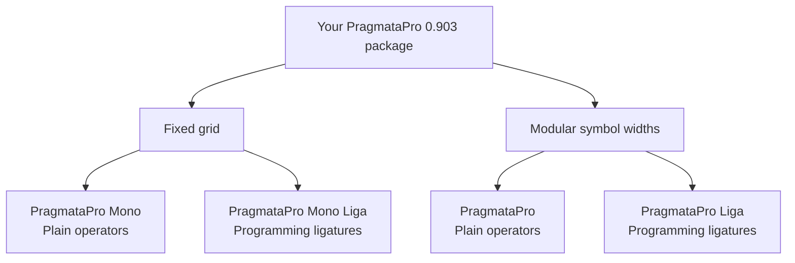
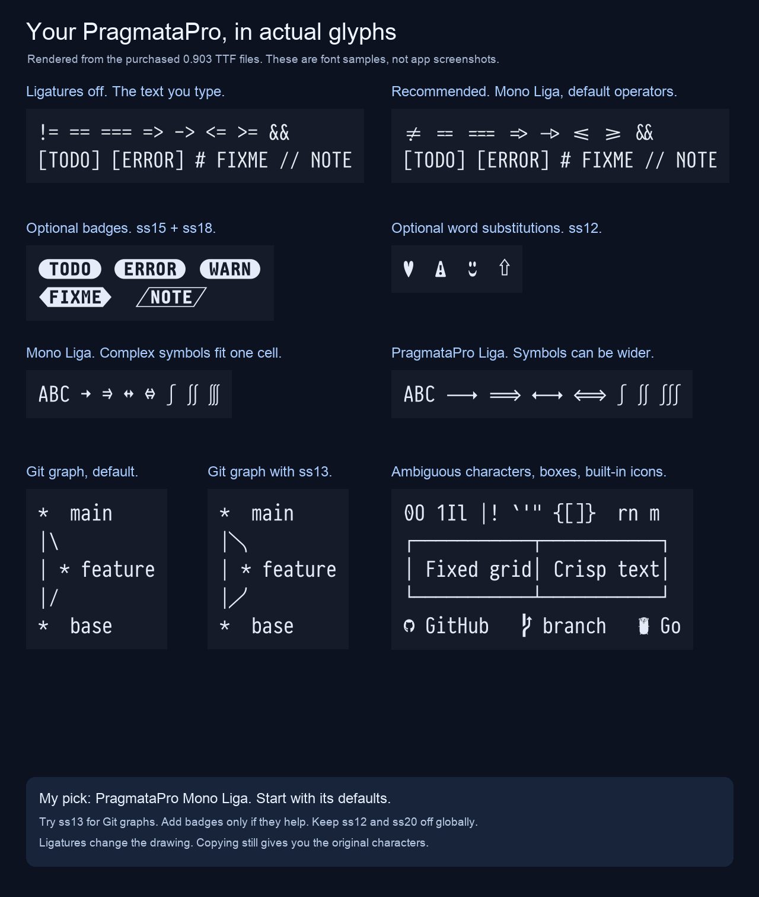
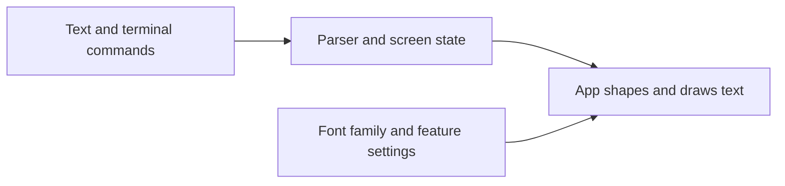

# Your PragmataPro font

I recommend **PragmataPro Mono Liga** for terminal work. Mono keeps the grid
predictable. Liga joins programming operators. Start with its default features.
Your Rex settings already show this family at 16 pt, Regular, with ligatures on.
This investigation did not change that setting.

These are actual glyphs from your files, rendered with HarfBuzz. They are not
screenshots of Ghostty, Rex, IDEA, or Obsidian. Application shaping can differ.

The [setup guide](../how-to/pragmatapro.md) contains copyable settings and
optional CSS. This PR selects Mono Liga in the repository's Ghostty config
and adds Rex's font preferences to its mise macOS defaults. The live machine
remains unchanged. Apply these values later through the normal dotfile and
bootstrap process.

## The four names describe two choices

| Family name in an app | Symbol widths | Programming ligatures |
| --- | --- | --- |
| `PragmataPro` | Modular | No |
| `PragmataPro Liga` | Modular | Yes |
| `PragmataPro Mono` | Fixed grid | No |
| `PragmataPro Mono Liga` | Fixed grid | Yes |

"Mono" controls widths. "Liga" supplies programming substitutions. They are
independent choices. The full modular family lets some complex symbols take
more space. Mono compresses them to fit its grid. Ordinary code letters keep
the familiar condensed design in both families.

Your Regular files contain 18,704 encoded characters in the full family and
15,734 in Mono. Their total glyph counts are 20,459 and 17,509. A glyph is a
drawing. Alternate drawings explain why glyph counts exceed character counts.
These counts come from `hb-info` on your actual 0.903 files.

Use Mono for terminals, aligned text, and code. Try the full family for
Obsidian prose with many symbols or mathematical text where its wider drawings
help. It does not turn ordinary prose into a proportional font.

Essential PragmataPro is the smaller English coding edition without ligatures.
It adds no useful capability to your full package. The variable font is a
separate product. I see no reason to buy it for this setup.

The designer documents the families on the [product page](https://fsd.it/shop/fonts/pragmatapro/)
and in the [0.903 handbook](https://fsd.it/pragmatapro/Handbook.png).

## You already have the desktop choices

The inspected directory is `~/Downloads/PragmataPro0.903`. It contains
16 TTF files and 16 optional OTF-CFF files. Each format supplies the four
families above, each with Regular, Bold, Italic, and Bold Italic.

For the recommended family, the TTF files are:

| Style | File |
| --- | --- |
| Regular | `PragmataPro_Mono_R_liga_0903.ttf` |
| Bold | `PragmataPro_Mono_B_liga_0903.ttf` |
| Italic | `PragmataPro_Mono_I_liga_0903.ttf` |
| Bold Italic | `PragmataPro_Mono_Z_liga_0903.ttf` |

`R`, `B`, `I`, and `Z` identify styles. `_liga` identifies the Liga family.
`0903` is the version. The app menu uses the internal family name,
`PragmataPro Mono Liga`, rather than the filename.

TTF is the practical starting choice. It includes the designer's TrueType
hinting. OTF-CFF is an alternative outline format, not a separate style or a
web license. Avoid installing both formats of the same family unless you
have a specific reason. Duplicate family registrations complicate matching.

No WOFF or WOFF2 files appear in this directory. That does not prove which
licenses you purchased. Check the order or other downloads for your web package.
Installing a font for personal display in these apps is the desktop use case.
Serving its files on a website is the web use case. Embedding files in an app
you distribute is another use case. The download's `COPYRIGHT+EULA.txt` gives
the purchased package's terms.

## Ligatures change the drawing

Typing `->` still stores two characters. A ligature draws them as a joined
arrow. Copying the text still gives the original characters. The same applies
to comparisons such as `!=` and `===`.

Tests of your Mono Liga file confirmed that operator glyphs change while
their total advance and character clusters remain the same. The tested
27-character operator line occupies 27 cells with ligatures both on and off.
This is font-level evidence. It does not prove every application's cursor
or selection behavior.

I recommend programming ligatures on. They suit your growing use of modern
terminal applications. Turn them off if a joined operator makes punctuation
harder for you to read. There is no requirement to use them to benefit from
PragmataPro's compact letters, distinct characters, symbols, or icons.

In these fonts, the programming switch is `calt`. The family name "Liga" is
not the OpenType tag `liga`. Your files contain no `liga` or `clig` feature
tag. Their `calt` tables do other contextual work too. Enabling `calt` on
the non-Liga family does not supply the missing operator substitutions.

## The large feature table is a menu

OpenType features tell an app which optional drawings to select. They are
not upgrades that you must enable together. `ss` means stylistic set. `cv`
means character variant. The number names a choice, not a quality level.

The most useful choices for this workflow are:

| Feature | Visible effect | My recommendation |
| --- | --- | --- |
| `calt` | Programming operators and contextual forms. | Keep the Liga defaults. |
| `ss13` | Curved joins in Git graphs. | First optional terminal experiment. |
| `ss15` | Badges for selected labels such as `[TODO]` and `[ERROR]`. | Optional. |
| `ss18` | Badges after `#` or `//`, followed by a space. | Optional. |
| `ss19` | Math strokes that match the Latin letters. | Try when writing math. |
| `cv01` | Alternate lowercase `l` forms. | Personal preference. |
| `cv02`, `cv03` | Alternate ampersands. | Choose one if desired. |
| `cv04`, `cv05` | Alternate equality and `<=` designs. | Compare before adopting. |
| `ss12` | Decorative substitutions, including words becoming symbols. | Leave off globally. |
| `ss20` | Reversed backgrounds for general bracketed text. | Leave off globally. |

For example, `ss12` can draw `love` as a heart and `warning` as a symbol.
That can be fun in a specimen. It can also obscure ordinary source text.
Version 0.903 separates selected keyword badges in `ss15` from the broader
bracket substitution in `ss20`.

The remaining sets cover alternate alphabets, old designs, Braille helpers,
poker notation, and LCD digits. They are specialized tools. You do not need
them for a complete coding setup.

The [handbook](https://fsd.it/pragmatapro/Handbook.png) shows before-and-after
samples. The [0.903 notes](https://fsd.it/blog/2025/10/23/pragmatapro-0-903-out-now/)
explain the changed badge behavior and new character variants. The optional
examples here use those tags, not an indiscriminate list of enabled sets.
The [current GitHub README](https://github.com/fabrizioschiavi/pragmatapro)
is brief. Use the handbook for the large feature matrix. It describes
capabilities rather than a setup checklist.

## Modern terminal support and font support are separate

A terminal engine interprets commands, colors, cursor movement, and protocols.
The renderer selects and draws glyphs. A newer engine does not automatically
give every app the same font controls.

The JetBrains announcement says exactly this. In IDEA 2026.3, libghostty
replaces the parser and screen-state engine. JetBrains still renders the text.
Ghostty's font config therefore does not become IDEA's font config.
Your installed IDEA 2026.2.3 predates that change. The announcement describes
2026.3 EAP, with the new engine also planned for the stable release.
[JetBrains terminal announcement](https://blog.jetbrains.com/platform/2026/10/jetbrains-terminal-now-uses-ghostty/).

| App or view | Recommended family | Relevant controls |
| --- | --- | --- |
| Ghostty | `PragmataPro Mono Liga` | Family and arbitrary `font-feature` tags. |
| Rex | `PragmataPro Mono Liga` | Terminal font and Ligatures in Settings. |
| IDEA editor | `PragmataPro Mono Liga` | Enable ligatures and character variants. |
| IDEA terminal | `PragmataPro Mono Liga` | Separate terminal font. Verify its displayed ligatures. |
| Obsidian code | `PragmataPro Mono Liga` | Built-in Monospace font and optional CSS. |
| Obsidian prose | Existing proportional font first. | Optional full PragmataPro family for symbol-heavy prose. |

IDEA added editor stylistic-set controls in 2026.1. Older advice that it cannot
select them is out of date. Its terminal has a separate font path. Source code
has a ligature path through the IDE color scheme, but exact terminal feature
inheritance was not verified here. The setup guide keeps that distinction.
[IDEA font controls](https://www.jetbrains.com/help/idea/settings-editor-font.html),
[terminal font source](https://github.com/JetBrains/intellij-community/blob/master/plugins/terminal/src/org/jetbrains/plugins/terminal/TerminalFontSettingsService.kt),
[terminal color scheme source](https://github.com/JetBrains/intellij-community/blob/master/plugins/terminal/src/org/jetbrains/plugins/terminal/block/ui/TerminalColorScheme.kt).

## Rex can be represented in TOML through mise

Rex's server config is `~/.config/rex/init.lua`. It controls bindings and
actions. The Mac client stores font preferences in the `com.superlogical.rex`
preference domain. These are separate systems. Rex does not read a native
font TOML file in the inspected build.

This repository already uses mise TOML to describe macOS preferences. This PR
adds Rex's font family, size, and ligature setting to that table. The setup
guide shows the included values. It does not track or symlink the whole Rex plist,
which also holds live window, server, and session state.

The observed family value is the family name, not the PostScript face name.
The stored size is a floating-point number. The live UI shows Ligatures on,
although the corresponding preference key is absent and uses its default.
These are observed internal preferences, not a documented stable Rex schema.
[Rex configuration documentation](https://www.superlogical.com/rex/docs/customize/config).

## More of what you paid for

The package includes built-in icon coverage, including Nerd Fonts 3.0-era
symbols. The specimen tests a GitHub mark, a branch symbol, and the Go gopher.
Try the supplied fonts before considering any icon patch. A missing newer
icon does not imply the whole font needs replacement.
[0.903 icon changes](https://fsd.it/blog/2025/10/23/pragmatapro-0-903-out-now/).

Use [PragmataPro Semiotics](https://fabrizioschiavi.github.io/pragmatapro-semiotics/)
to find symbols by name or codepoint. It is more useful than scanning a giant
image. The page warns that Safari does not preview locally installed fonts
there. A missing web preview does not by itself prove a missing glyph.

Use the [plain character list](https://fsd.it/pragmatapro/All_chars.txt) when
you need an actual codepoint. The [full character image](https://fsd.it/pragmatapro/All_chars.png)
is a visual catalog. The [Mono comparison image](https://fsd.it/pragmatapro/All_chars_Mono_comparison.png)
shows width and coverage differences. Its header identifies 0.9, so the
local 0.903 files are the authority for exact current coverage.

The font also has extensive box drawing and mathematical symbols. Terminal
renderers may draw some box characters themselves. A clean terminal border
therefore does not prove that a particular font supplied it.

## A custom font is unnecessary here

Runtime feature settings cover the useful Ghostty and Obsidian choices.
IDEA now exposes editor variants. Rex already has a ligature switch. A custom
binary would add a rebuild task every time the font changes.

There is also a conflict in the supplied material. The designer publishes
[customization tools](https://github.com/fabrizioschiavi/pragmatapro/tree/master/merge_stylistic_sets),
but your bundled EULA v4.0 prohibits modifying or converting the font.
This investigation does not resolve that conflict. My recommendation is to
use the supplied fonts and app feature settings. If you later need a baked-in
variant, obtain clarification from the designer first.

## What was checked

The investigation inspected the local font names, formats, feature tables,
and representative shaping. It rendered the specimen from the TTF files.
It read the handbook, official release notes, app docs, and relevant IDEA
source. It inspected Rex's font settings without changing them.

Installed versions observed on 2026-10-28 were Ghostty 1.4.0, Rex 0.1.0
build 1408, IDEA 2026.2.3, and Obsidian 1.14.5. Rex's later live UI observation
showed Mono Liga at 16 pt. Earlier disk preferences showed 15 pt. The current
UI and subsequent preference read agree on 16 pt. No investigation command
changed those values.

The [evidence notes](../examples/pragmatapro/evidence.md) contain repeatable
read-only commands and verification limits. No purchased font binaries,
webfonts, or private app-state files belong to this PR.
